# Hipster for Zed

Bold, terminal-style themes for Zed. It started as a port of Hipster Green from iTerm2/Tabby and now has 14 variants.

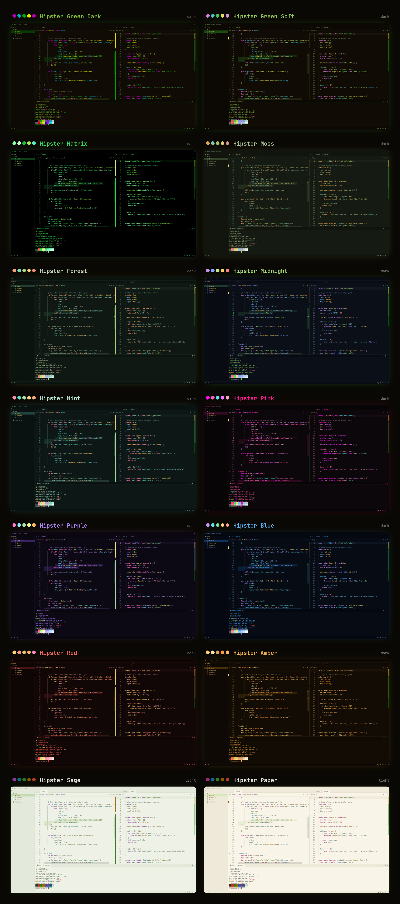

## Install

In Zed, open the command palette, run `zed: extensions`, search for **Hipster** and install it. Then pick a variant with `theme selector: toggle`.

## Variants

Dark:

- **Hipster Green Dark**: the original iTerm2/Tabby scheme, kept exact
- **Hipster Green Soft**: same colors, but the dim purple and blue are brighter so they're easier to read
- **Hipster Matrix**: pure black and only greens, like an old CRT
- **Hipster Moss**: muted earthy greens for long sessions
- **Hipster Forest**: deep pine background with warm fruit colors
- **Hipster Midnight**: blue-black background with neon green text
- **Hipster Mint**: teal dark with mint text and pink highlights
- **Hipster Pink**: neon pink, palette from the [hipster-pink](https://github.com/physetersarealwayshigh/hipster-pink-zed-theme) fork
- **Hipster Purple**: violet night with candy accents
- **Hipster Blue**: deep navy with electric blue text
- **Hipster Red**: dark red room with warm coral text
- **Hipster Amber**: orange, like an old amber monitor

Light:

- **Hipster Sage**: soft sage paper with green ink
- **Hipster Paper**: warm cream paper, like printed code

Every variant except the original keeps text at 4.5:1 contrast or better. The original stays exact to the source scheme, so its purple and blue are a bit dimmer.

## Screenshots

| | |
|---|---|
| 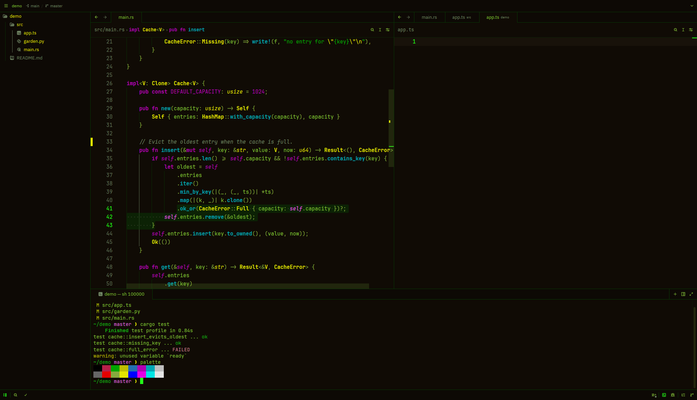 | 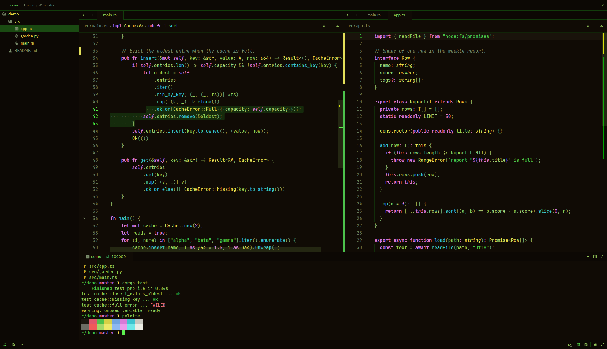 |
| 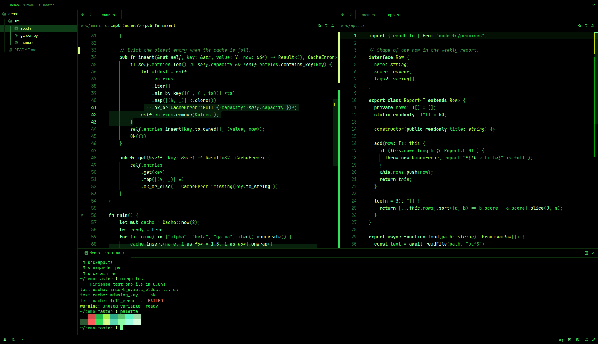 | 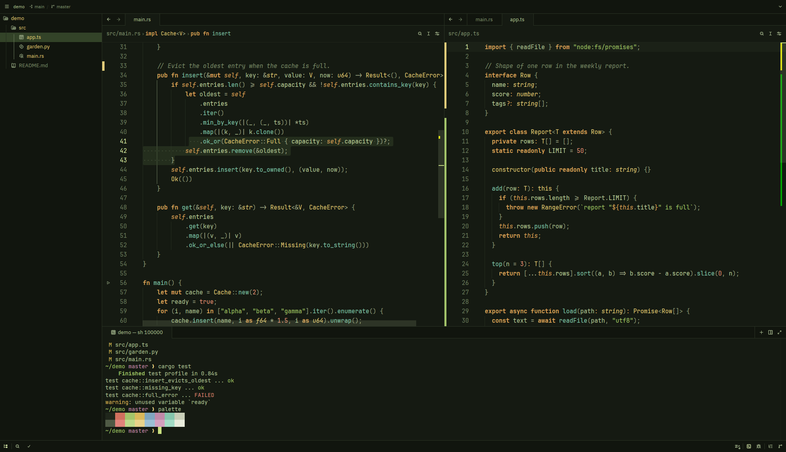 |
| 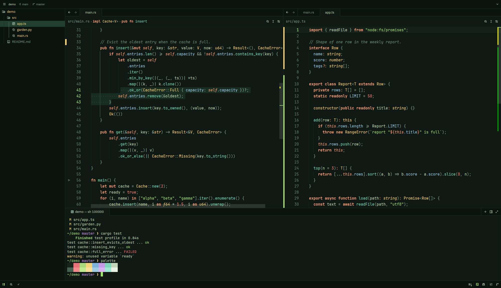 | 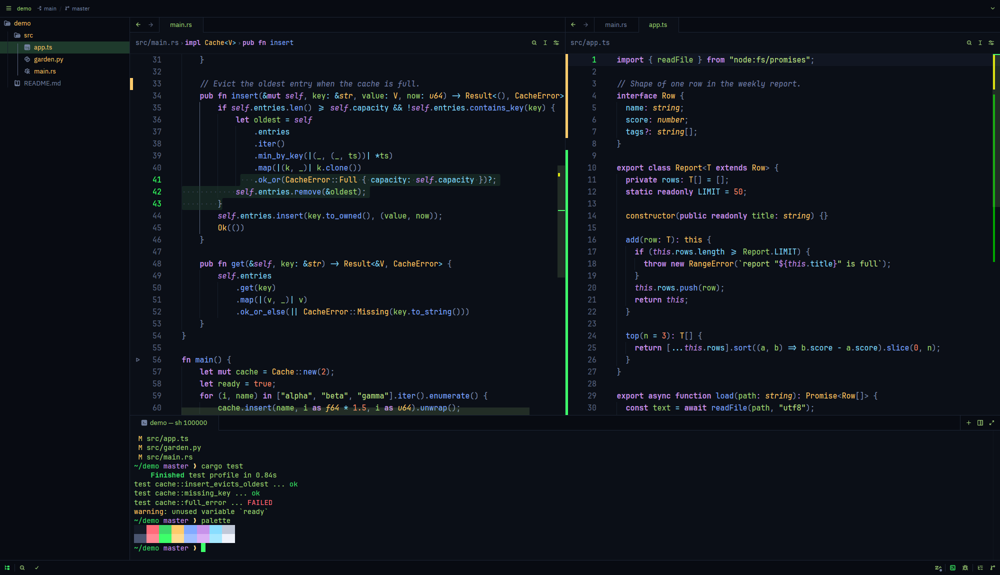 |
| 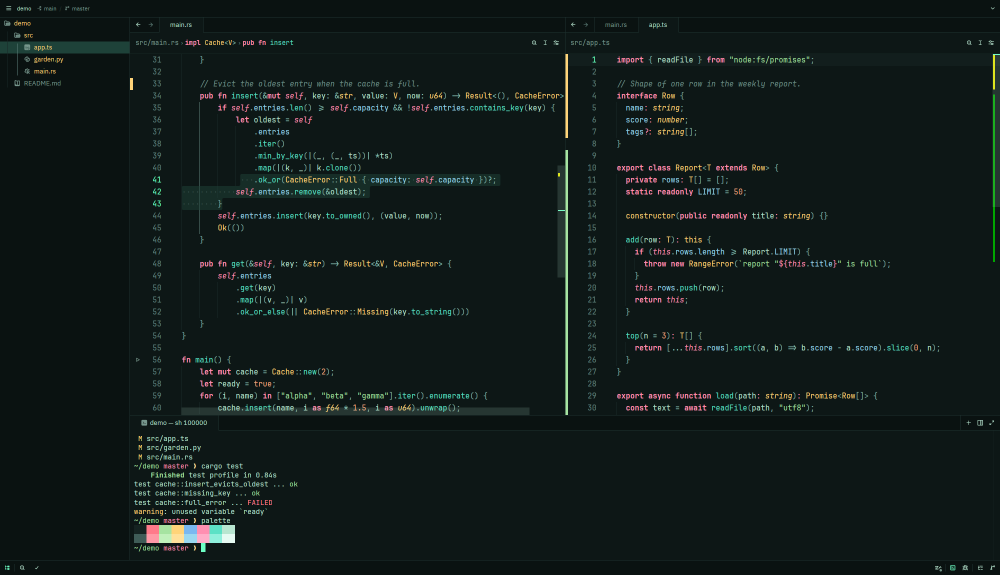 | 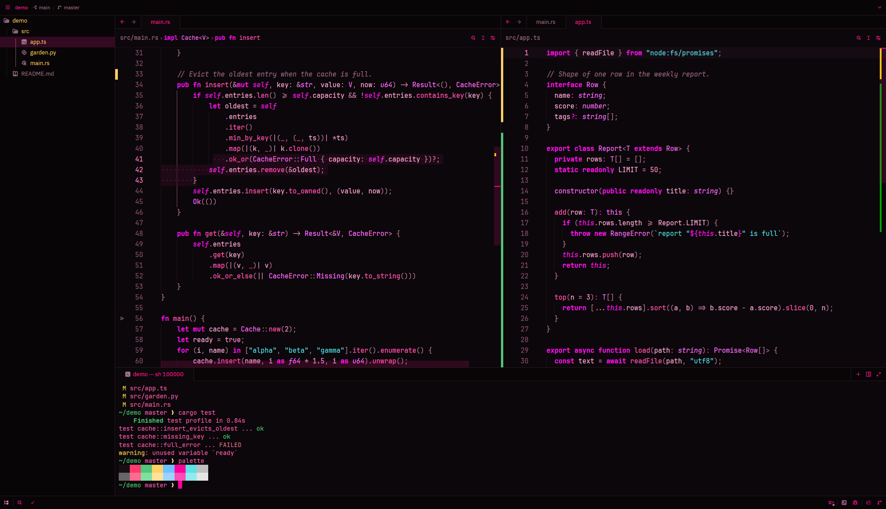 |
| 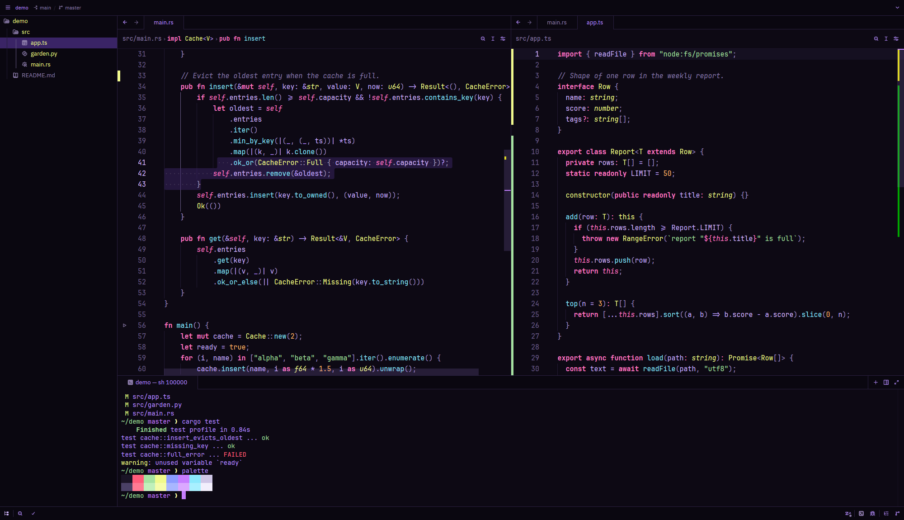 | 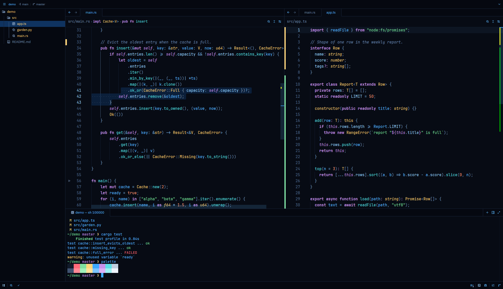 |
| 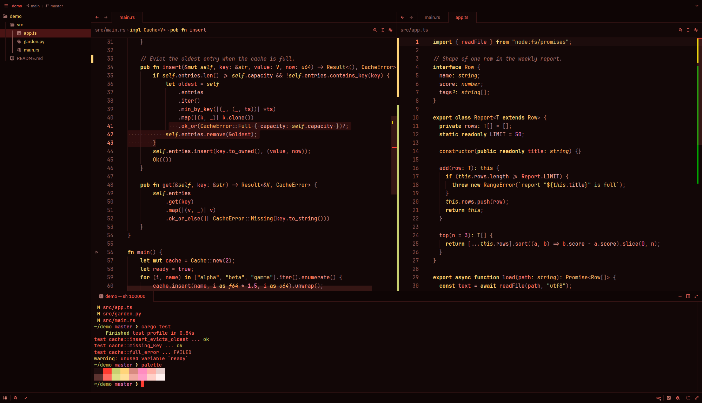 | 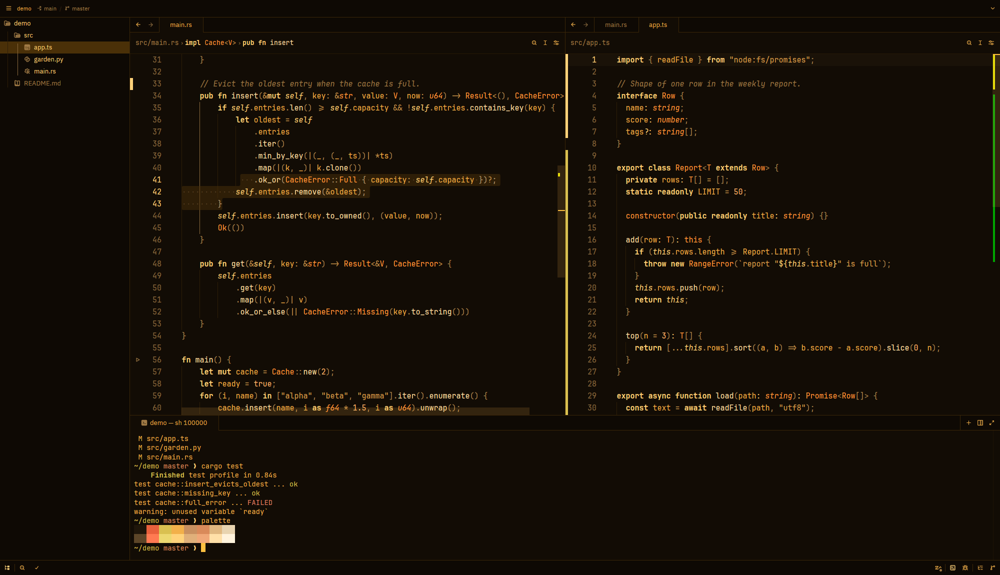 |
| 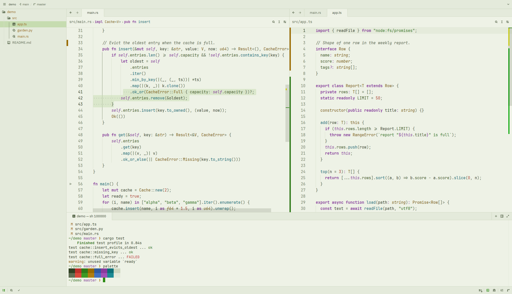 | 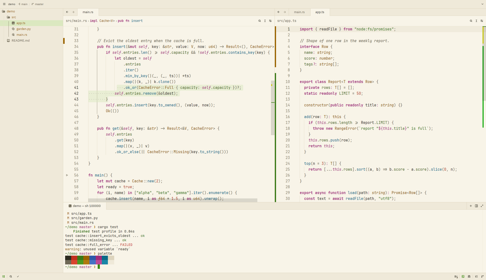 |

Shown with JetBrains Mono.

## Editing the themes

All variants are generated from `scripts/gen.py`. Change a palette there and run:

```sh
python3 scripts/gen.py          # rewrites themes/hipster.json
python3 scripts/gen.py --check  # contrast report only
python3 scripts/preview.py      # rebuilds screenshots/preview.png
```

Don't edit the JSON by hand, it gets overwritten.

## License

MIT
