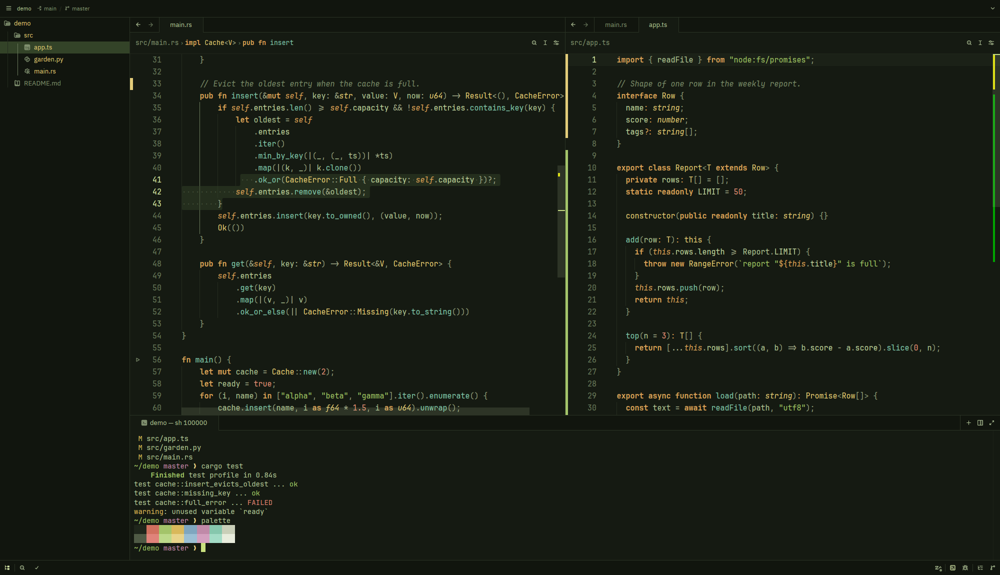
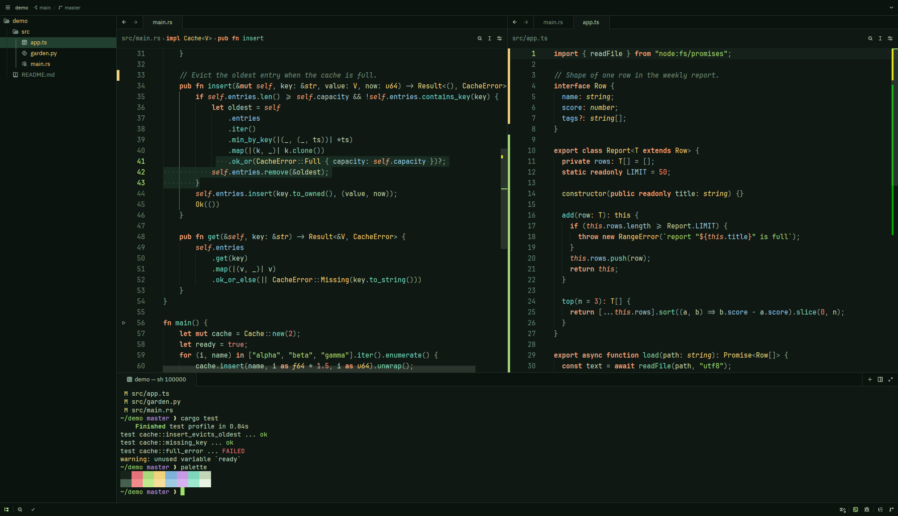
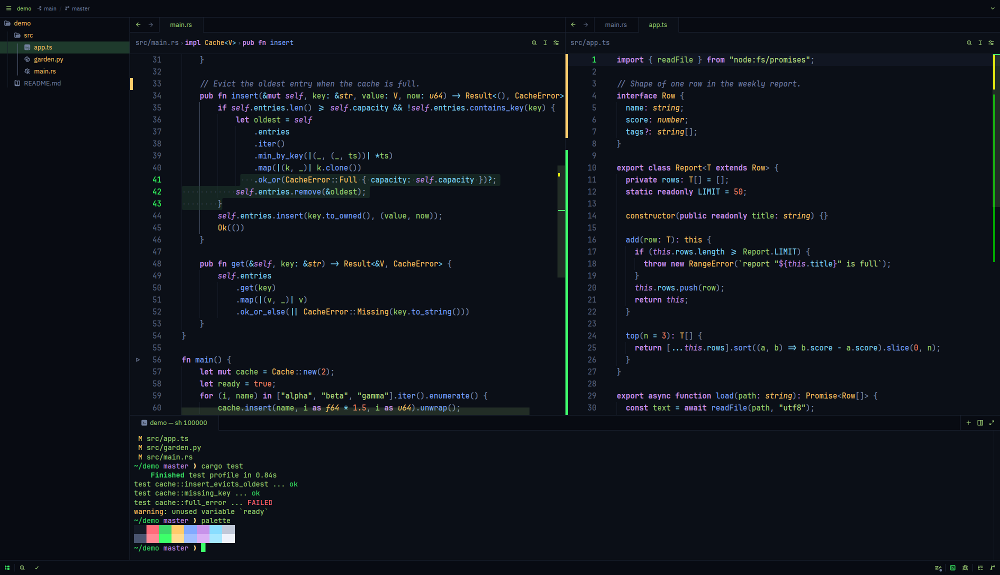
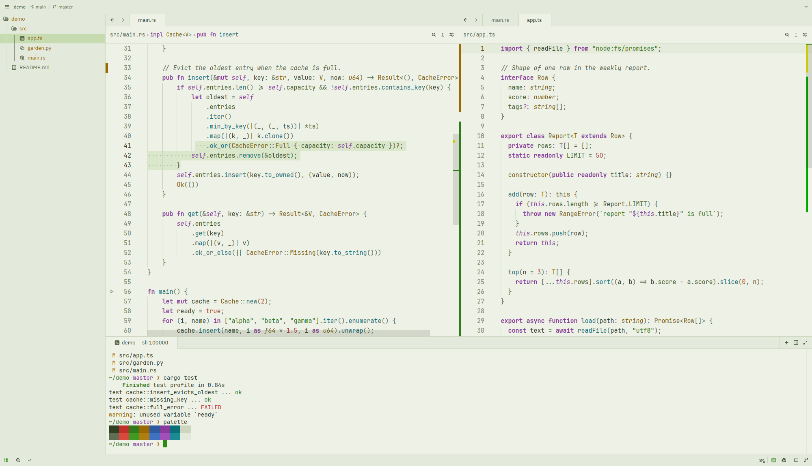
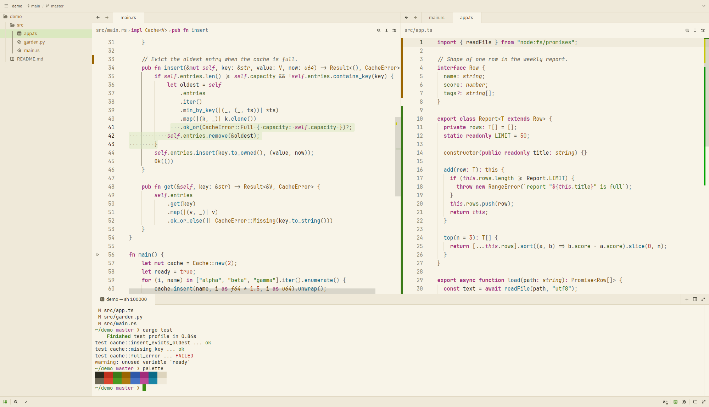

# Hipster Green for Zed

A port of the Hipster Green color scheme from iTerm2/Tabby, plus nine variants built on the same idea.


## Install

In Zed, open the command palette, run `zed: extensions`, search for **Hipster Green** and install it. Then pick a variant with `theme selector: toggle`.

## Variants

- **Hipster Green Dark**: the original scheme, kept exact
- **Hipster Green Soft**: same colors, but the dim purple and blue are brighter so every token is easy to read
- **Hipster Green Matrix**: pure black and only greens, like an old CRT
- **Hipster Green Moss**: muted earthy greens for long sessions
- **Hipster Green Forest**: deep pine background with warm fruit colors
- **Hipster Green Midnight**: blue-black background with neon green text
- **Hipster Green Mint**: teal dark with mint text and pink highlights
- **Hipster Amber**: the amber monitor sibling, warm orange phosphor
- **Hipster Green Sage** (light): soft sage paper with green ink
- **Hipster Green Paper** (light): warm cream paper, like printed code

Every variant except the original keeps text at 4.5:1 contrast or better against the background. The original stays exact to the source scheme, so its purple and blue are a bit dimmer.

## Screenshots

| | |
|---|---|
|  |  |
|  |  |
|  |  |
|  |  |
|  |  |

Shown with JetBrains Mono.

## Original palette

- Text `#84c138`
- Cursor `#23ff18`
- Background `#100b05`
- Selection `#083905`
- Strings `#00a600`, functions `#00a6b2`, types `#e5e500`, keywords `#b200b2`

## Editing the themes

All variants are generated from `scripts/gen.py`. Change a palette there and run:

```sh
python3 scripts/gen.py          # rewrites themes/hipster-green.json
python3 scripts/gen.py --check  # contrast report only
python3 scripts/preview.py      # rebuilds screenshots/preview.png
```

Don't edit the JSON by hand, it gets overwritten.

## License

MIT
